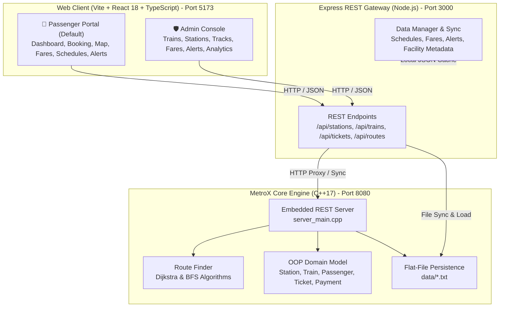

# MetroX — Smart Metro Transit Management System

[](https://isocpp.org/)
[](https://nodejs.org/)
[](https://expressjs.com/)
[](https://react.dev/)
[](https://www.typescriptlang.org/)
[](https://tailwindcss.com/)
[](https://vitejs.dev/)

A modern, production-grade **Full-Stack Urban Transit Authority System** simulating the metropolitan metro network (inspired by Nagpur Metro's North-South Orange Line and East-West Aqua Line). 

MetroX combines high-performance **C++17 Object-Oriented Core Engine** (graph algorithms, memory-safe data structures, and flat-file persistence) with a lightweight **Node.js/Express REST Gateway** and a **React 18 + TypeScript Web Portal** featuring separated **Passenger** and **Admin** consoles.

---

## 🏛️ System Architecture



---

## ✨ Dual-Portal Features

The application is cleanly divided into two dedicated portals with an instant role-switch toggle in the navigation bar.

### 👤 1. Passenger Portal (Default View)
Designed for urban commuters navigating the transit network:

1. **Passenger Dashboard:** Commuter landing page featuring network punctuality (99.4%), active fleet status, quick booking shortcuts, and live journey pass cards.
2. **Book Metro Ticket:** Station selector, passenger concessions (Regular, Student 20% off, Senior 30% off), train selection, and instant token generation with QR code.
3. **Cancel Ticket:** Search ticket by ID, automated 80% refund calculation, and instant seat de-allocation.
4. **My Tickets & Booking History:** Boarding pass cards with QR codes, origin/destination itinerary, fare breakdown, and booking status (`CONFIRMED` / `CANCELLED`).
5. **Interactive Metro Map:** Colour-coded schematic SVG subway map displaying the Orange Line, Aqua Line, and **Sitabuldi Interchange** with clickable station amenities.
6. **View Metro Routes & Interchanges:** Journey path solver comparing **Dijkstra** (shortest physical distance) vs **BFS** (fewest station hops) with transfer directions.
7. **Train Timings & Schedules:** Network timetable displaying first train (06:00 AM), last train (11:00 PM), and operating frequencies across peak and non-peak hours.
8. **Check Fare Between Stations:** Dynamic fare estimator calculating route distance, station hops, standard rates, smart card discounts, and concession eligibility.
9. **View Station Details & Facilities:** Comprehensive 37-station directory detailing wheelchair ramps, elevators/lifts, feeder bus bays, parking, and TVMs.
10. **Service Alerts & Delays:** Real-time operational advisories, maintenance notices, and pacing updates filtered by line.
11. **My Profile & Preferences:** Commuter transit card balance, simulated one-click recharge, default home/work stations, and green carbon offset tracker.
12. **Logout:** Resets user session state and returns to default passenger dashboard.

---

### 🛡️ 2. Admin Authority Console
Designed for transit operators, traffic controllers, and station managers:

1. **Admin Dashboard:** High-level KPIs (active train fleet, network stations, total passengers, gross revenue), active alert notices, and management shortcuts.
2. **Train Management:** Add new train rakes, edit seating capacity and operational status (`IN_SERVICE`, `MAINTENANCE`, `RETIRED`), and decommission trains with automatic sync to `data/trains.txt` and C++ reload.
3. **Station Management:** Add new stations, modify station name/line assignment, and delete stations with automatic cascade cleanup of connected tracks.
4. **Track & Route Management:** Configure bilateral track connections between stations, customize track distance (in km), and remove obsolete rail links.
5. **Passenger Management:** Commuter registry with search by name, contact details, travel history, and total spending.
6. **Ticket Management:** Global passenger ticketing ledger showing boarding status, train assignments, and seat numbers.
7. **Train Capacity & Availability:** Live fleet occupancy bars, occupied vs total seats, occupancy percentage, and fleet availability status badges.
8. **Train Timings & Schedule Management:** Edit peak/off-peak headway, manage first/last departure times, add corridor schedules, and delete outdated runs.
9. **Fare Management:** Fare matrix editor to adjust base fare (₹10), rate per km (₹3.5), concession discount percentages, and minimum fare.
10. **Service Alerts & Maintenance Management:** Broadcast transit advisories, track maintenance notices, and pacing delay warnings with severity indicators (`WARNING`, `CRITICAL`, `INFO`, `SUCCESS`).
11. **Revenue & Booking Analytics:** Financial reports on gross and net revenue, refund percentages, payment channel distribution (UPI, Cards, Cash), and top transit corridors.
12. **Logout:** Terminates administrative session and safely returns to the Passenger Portal.

---

## 💻 Tech Stack & OOP Concepts

### Tech Stack
| Tier | Technology | Purpose |
|---|---|---|
| **Frontend** | React 18, TypeScript, Vite, Tailwind CSS, Lucide Icons | Responsive commuter and admin interface |
| **Gateway** | Node.js, Express, CORS | RESTful API gateway, file synchronization, metadata cache |
| **Core Engine** | C++17 (`clang++` / `g++`), POSIX Sockets | Core business logic, Dijkstra & BFS graph algorithms, CLI |
| **Storage** | Flat files (`data/*.txt`) + JSON (`data/transit_meta.json`) | In-engine and gateway data persistence |

### C++ Object-Oriented Principles Implemented
- **Encapsulation:** Private attributes in `Station`, `Train`, `Passenger`, `Ticket`, and `Route` guarded by validated accessors. Strict capacity invariants prevent negative seating or overselling.
- **Inheritance:** `StudentPassenger` and `SeniorPassenger` inherit from base `Passenger`. `UPIPayment`, `CardPayment`, and `CashPayment` derive from abstract interface `Payment`.
- **Runtime Polymorphism:** Storing passengers as `std::unique_ptr<Passenger>` with dynamic dispatch on `getDiscount()` (`0%` Regular, `20%` Student, `30%` Senior) and `Payment::pay()`.
- **Graph Algorithms:**
  - **Dijkstra's Algorithm:** Min-heap priority queue finding the shortest physical track distance ($km$).
  - **Breadth-First Search (BFS):** Queue-based level-order traversal finding the path with the minimum number of station hops/transfers.
- **Memory Safety:** Modern C++ RAII using `std::unique_ptr` and standard STL containers (`std::vector`, `std::map`, `std::priority_queue`, `std::queue`).

---

## 🚀 Quick Start Guide

### Prerequisites
- **macOS** or **Linux**
- **C++17** compiler (`clang++` or `g++`)
- **Node.js** (v18+) and **npm**
- **GNU Make**

### 1. Clone & Setup
```bash
git clone https://github.com/your-username/metroX2.git
cd metroX2
```

### 2. Install Dependencies
```bash
# Install Express server dependencies
cd server && npm install && cd ..

# Install React frontend dependencies
cd frontend && npm install && cd ..
```

### 3. Build & Run Everything

You can use the root `Makefile` to control the entire stack:

```bash
# View available Makefile commands
make help

# Build the C++ CLI & REST server binaries
make build
```

Open three terminal windows (or tabs) to start the full stack:

#### Terminal 1 — C++ REST Core Engine (Port 8080)
```bash
make start-cpp
```

#### Terminal 2 — Node.js Express Gateway (Port 3000)
```bash
make start-server
```

#### Terminal 3 — React Vite Frontend (Port 5173)
```bash
make start-frontend
```

Once running, navigate to:
👉 **[http://localhost:5173/](http://localhost:5173/)**

---

## 📟 Standalone Interactive C++ Terminal CLI

If you want to run the project in purely offline C++ terminal mode:

```bash
make run-cli
```

Provides an interactive CLI menu for station management, track connections, passenger registration, route finding (BFS/Dijkstra), ticketing, and cancellation.

---

## 📡 REST API Reference (Express Gateway - Port 3000)

| Endpoint | Method | Description |
|---|---|---|
| `/api/health` | `GET` | Health check and engine connection status |
| `/api/stations` | `GET`, `POST` | List all stations or create a new station |
| `/api/stations/:id` | `PUT`, `DELETE` | Update station or delete station with track cleanup |
| `/api/stations/connect` | `POST`, `PUT`, `DELETE` | Add, update distance, or disconnect tracks |
| `/api/trains` | `GET`, `POST` | List all trains or register a new train |
| `/api/trains/:id` | `PUT`, `DELETE` | Update train capacity/status or delete train |
| `/api/trains/availability` | `GET` | Fleet availability and seat occupancy breakdown |
| `/api/passengers` | `GET`, `POST` | List passengers or register new commuter |
| `/api/tickets` | `GET`, `POST` | List tickets or book a new journey ticket |
| `/api/tickets/cancel` | `POST` | Cancel ticket and release seat |
| `/api/routes` | `GET` | Calculate shortest route (`?source=&destination=&algo=dijkstra\|bfs`) |
| `/api/schedules` | `GET`, `POST`, `PUT`, `DELETE` | Manage timetable departures and peak frequency |
| `/api/fares` | `GET`, `PUT` | Read or update network fare tariff configuration |
| `/api/alerts` | `GET`, `POST`, `PUT`, `DELETE` | Read or broadcast operational transit advisories |
| `/api/facilities` | `GET`, `PUT` | Read or update station amenities and accessibility data |
| `/api/profile` | `GET`, `PUT` | Read commuter profile, recharge smart card, save preferences |
| `/api/analytics` | `GET` | Revenue, booking status, and corridor statistics |

---

## 📂 Repository Structure

```text
metroX2/
├── Makefile                        # Root build automation (build, start-cpp, start-server, start-frontend)
├── README.md                       # Main project documentation for GitHub
├── server/                         # Node.js Express Gateway (Port 3000)
│   ├── index.js                    # REST API routes and C++ synchronization proxy
│   ├── dataManager.js              # Persistence manager for schedules, fares, alerts, profile
│   └── package.json
├── frontend/                       # Vite + React 18 + TypeScript UI (Port 5173)
│   ├── src/
│   │   ├── components/             # Navbar, Footer, RouteVisualizer
│   │   ├── pages/                  # 14 distinct pages for Passenger & Admin consoles
│   │   │   ├── PassengerDashboardPage.tsx
│   │   │   ├── BookingPage.tsx
│   │   │   ├── CancelTicketPage.tsx
│   │   │   ├── MyTicketsPage.tsx
│   │   │   ├── MetroMapPage.tsx
│   │   │   ├── RoutesInterchangesPage.tsx
│   │   │   ├── SchedulesPage.tsx
│   │   │   ├── FareCheckPage.tsx
│   │   │   ├── StationFacilitiesPage.tsx
│   │   │   ├── AlertsPage.tsx
│   │   │   ├── ProfilePage.tsx
│   │   │   ├── AdminDashboardPage.tsx
│   │   │   ├── TrainsPage.tsx
│   │   │   ├── StationsPage.tsx
│   │   │   ├── TrackManagementPage.tsx
│   │   │   ├── PassengersPage.tsx
│   │   │   ├── TicketsPage.tsx
│   │   │   ├── TrainCapacityPage.tsx
│   │   │   └── AnalyticsPage.tsx
│   │   ├── services/api.ts         # Axios/Fetch API client
│   │   ├── types/metro.ts          # TypeScript interfaces
│   │   ├── App.tsx                 # Portal router and state manager
│   │   └── main.tsx
│   ├── package.json
│   └── tailwind.config.js
└── MetroX Project/metrox/          # C++17 Core Engine (Port 8080)
    ├── include/                    # Header files (Station, Train, Passenger, Payment, etc.)
    ├── src/                        # Implementations (MetroSystem, RouteFinder, FileManager)
    ├── data/                       # Flat text files (stations.txt, trains.txt, passengers.txt, tickets.txt)
    ├── main.cpp                    # Interactive terminal CLI entrypoint
    ├── server_main.cpp             # Embedded C++ REST server entrypoint
    └── Makefile                    # C++ compilation recipes
```

---

## 🧪 Testing & Verification

- **Production Build:** The frontend compiles cleanly with strict TypeScript checks:
  ```bash
  cd frontend && npm run build
  ```
- **Live Health Status:** Check both Express and C++ Engine connectivity:
  ```bash
  curl http://localhost:3000/api/health
  ```
- **CLI Interactive Tests:** Test graph pathfinding and polymorphic ticketing logic directly:
  ```bash
  make run-cli
  ```

---

## 👥 Contributors & Acknowledgements

Developed as an advanced demonstration of **Object-Oriented Programming (OOP) in C++17**, modern full-stack web architecture, and clean separation of concerns for metropolitan smart transit management.
